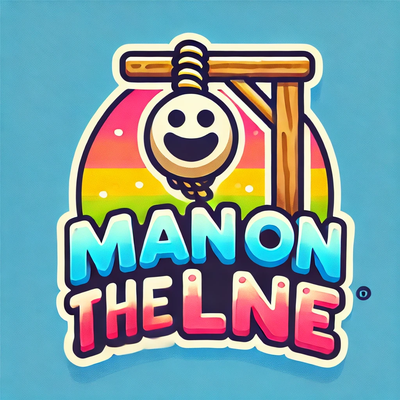

<p align="center">
  
</p>

<h1 align="center">Man On The Line</h1>

<p align="center">
  <b>The "Epic" Word Game You Didn't Ask For.</b><br>
  A terminal hangman game that roasts you for every wrong letter.
</p>

<p align="center">
  <a href="https://github.com/gc10code/manontheline/actions/workflows/tests.yml"></a>
  
  
  <a href="LICENSE"></a>
</p>

```
  +---+
  |   |     Two arms! Wow, you're building me faster than IKEA furniture!
  O   |     Feeling proud yet? 🤗
 /|\  |
      |
      |
=========

✨ The Unreachable Word:  S U B M A R _ N E

      Q W E R T Y U I O P
       A S D F G H J K L
        Z X C V B N M

📝 Your Gallery of Shame: O T L C
💝 Attempts Until I Can Laugh at Your Loss: ❤️ ❤️ 🖤 🖤 🖤 🖤

🏆 Score: 1150 | 🔥 Streak: 2 | ⚡ Combo: x2 | 💡 Hints: 2
Nope. The rope thanks you for your cooperation. 🪢
```

## Features

- **6 game modes**
  | Mode | What it does |
  |---|---|
  | 🎯 **Classic** | The original suffering. 6 lives, one word at a time. |
  | ⏱️ **Time Attack** | Beat the clock (60 / 75 / 90 s per word). Points x1.5. |
  | 💀 **Sudden Death** | One life. One mistake. Points x3. |
  | 🏃 **Marathon** | Lives carry over between words, +1 life per word survived. How far can you go? |
  | 📅 **Daily Challenge** | Same word for everyone each day, one shot, with a shareable result grid. |
  | 🤝 **Versus** | Two players on one keyboard: one types a hidden secret word, the other guesses. Then swap. |
- **Scoring with combos**: consecutive correct letters build a multiplier up to x3, plus speed, lives, flawless and difficulty bonuses.
- **Go for glory**: type the whole word to solve it instantly. Wrong costs 2 lives.
- **Hints**: `!` reveals a letter for 150 points (max 2 per word).
- **23 achievements**, from *First Blood* to *Vowel Hater* and *Professional Loser*, with a couple of secret ones.
- **Statistics**: win rate, streaks, fastest win, favorite letter, and a histogram of mistakes on winning games.
- **Local Hall of Fame** with per-mode leaderboards.
- **Animations**: confetti, a dancing (rescued) man, a swinging (not rescued) man, a colored on-screen keyboard.
- **Ranks** from *Clueless Rookie* to *The Hangman's Nightmare*.
- **Easter eggs**. There's a Konami code. There are secret commands. Good luck.
- **Your own words**: drop extra word lists in your data folder (see below).
- Progress is saved automatically. Works on Windows, macOS and Linux.

## Quick start

Requires Python 3.10+.

```bash
git clone https://github.com/gc10code/manontheline.git
cd manontheline
pip install -r requirements.txt
python manontheline.py
```

or `python -m motl`.

### Command line options

```
python manontheline.py [--difficulty {easy,medium,hard}]
                       [--mode {classic,time,sudden,marathon,daily,versus}]
                       [--words DIR] [--no-anim] [--no-save] [--seed N] [--version]
```

| Option | Meaning |
|---|---|
| `--mode` | Jump straight into a game mode |
| `--difficulty` | Set the default difficulty |
| `--words DIR` | Extra folder with `easy.txt` / `medium.txt` / `hard.txt` |
| `--no-anim` | Disable animations for this run |
| `--no-save` | Don't read or write the save file |
| `--seed N` | Reproducible word picks |

## How to play

| Input | Action |
|---|---|
| a single letter | Guess that letter |
| the whole word | Solve it now (wrong = -2 lives, you'll be asked to confirm) |
| `!` | Hint: reveal a letter (-150 points) |
| `?` | Show controls |
| `:q` | Give up |

### Scoring

| Source | Points |
|---|---|
| Correct letter | 100 per occurrence, times the combo multiplier (x1, x1.5, x2 … up to x3) |
| Win | +500 |
| Speed | up to +1000 (minus 10 per second) |
| Lives left | +100 each |
| Flawless | +300 |
| Whole-word solve | +75 per letter that was still hidden |
| Difficulty | x1 / x1.5 / x2 |
| Mode | Time Attack x1.5, Sudden Death x3 |

Lose the round and you keep nothing but the shame.

## Custom words

Word lists are plain text files, one word per line. Spaces and hyphens are allowed (`ICE CREAM`, `ROLLER COASTER`) and are shown automatically. Lines starting with `#` are ignored. Accents are stripped.

Put your own `easy.txt`, `medium.txt` and/or `hard.txt` in the data folder and they are added to the built-in lists:

| OS | Data folder |
|---|---|
| Windows | `%APPDATA%\manontheline\words` |
| macOS | `~/Library/Application Support/manontheline/words` |
| Linux | `~/.local/share/manontheline/words` (or `$XDG_DATA_HOME`) |

The save file (`save.json`) lives in the parent folder. Set `MOTL_HOME` to use a different location.

## Build a standalone executable

```bash
pip install -r requirements-dev.txt
pyinstaller manontheline.spec
```

The single-file executable ends up in `dist/`. Pushing a tag like `v3.0.0` builds the Windows `.exe` with GitHub Actions and attaches it to a release.

## Development

```bash
pip install -r requirements-dev.txt
python -m pytest
```

```
manontheline.py      launcher
motl/
  engine.py          pure game logic (rounds, scoring, hints) - no I/O
  words.py           word list loading, random and daily picks
  storage.py         save file: settings, stats, leaderboard, daily results
  achievements.py    achievement definitions and unlock rules
  game.py            menus, game modes and screens
  ui.py              terminal rendering and animations
  art.py             ASCII art and stage commentary
  text.py            every line of sarcasm
words/               built-in word lists
tests/               unit tests and scripted end-to-end runs
```

## What's new in 3.0

- New modes: Time Attack, Sudden Death, Marathon, Daily Challenge, Versus
- Combo multiplier, hints, whole-word guesses, detailed score breakdown
- Achievements, statistics, ranks and a local Hall of Fame, saved between sessions
- Animations, colored keyboard, rainbow mode, optional terminal bell
- Bigger word lists; multi-word entries like `ICE CREAM` are now winnable (they used to be impossible)
- Fixed typos in word lists and the "Best Streak" shown at the end
- The packaged executable now finds its word lists from any working directory
- Clean exit on Ctrl+C, corrupted save files are set aside instead of crashing
- Test suite and CI

## License

[MIT](LICENSE) © gc10code
